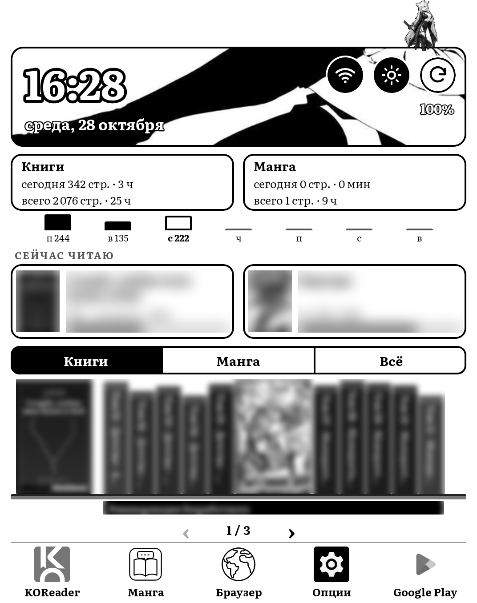
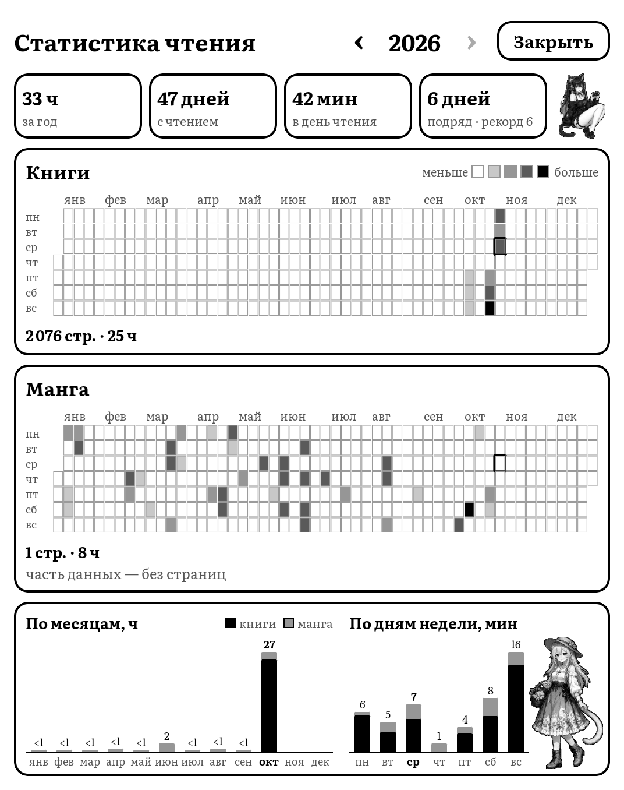
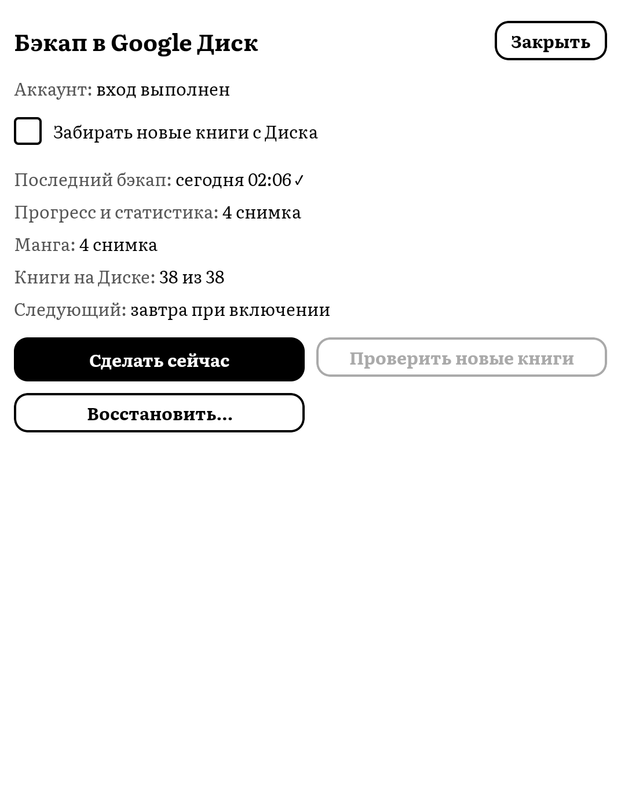
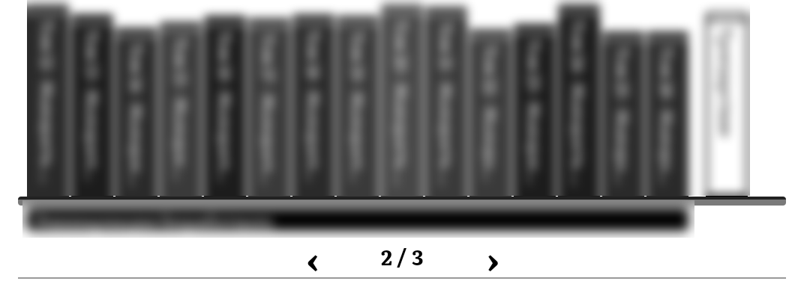

# Nekoshelf Launcher

Лаунчер для Android e-ink ридеров: полка книг KOReader, статистика, «Сейчас читаю», мост к манга-приложению и бэкап в Google Drive. Сделан под Meebook E6, но не привязан к нему.

*English summary: an Android launcher for e-ink readers, built around KOReader. It has a bookshelf, reading statistics, "now reading", a bridge to the Nekoshelf Manga app (a Komikku fork reworked for e-ink), an e-ink-friendly UI, Google Drive backup/restore and optional catgirl decor. Install: grab both APKs from [Releases](https://github.com/s4m1ches/nekoshelf/releases/latest), install Nekoshelf Manga first, then the launcher, and just sign in to Google for backups — no setup needed. Self-builds need their own OAuth client. Tested on the Meebook E6. Apache-2.0. Not affiliated with Meebook.*

Проекты: **Nekoshelf Launcher** (этот репозиторий), [**Nekoshelf Manga**](https://github.com/s4m1ches/nekoshelf-manga) (форк [Komikku](https://github.com/komikku-app/komikku), переделанный под e-ink: без анимаций, чёрно-белый, списки листаются страницами), **Nekoshelf KOReader Kit** (`koreader-kit/`).

## Скриншоты

<p>



</p>
<p></p>

*Названия и обложки книг на скриншотах размыты.*

## Установка

1. Откройте [последний релиз](https://github.com/s4m1ches/nekoshelf/releases/latest) и скачайте на ридер:
   - `nekoshelf-manga-…-arm64-v8a.apk` (для большинства ридеров; для старых 32-битных — `…-armeabi-v7a.apk`);
   - `nekoshelf-launcher-….apk`.
2. Установите **сначала Nekoshelf Manga, потом лаунчер** — иначе лаунчер не получит доступ к манге (тогда просто переустановите лаунчер).
3. Нажмите «Домой» → «Nekoshelf Launcher» → «Всегда».
4. Для бэкапа: свайп вверх → «☁ Бэкап» → «Войти в Google». Больше ничего настраивать не нужно.

Оба приложения из релизов подписаны одним ключом; обновления ставятся поверх. Установить [KOReader](https://koreader.rocks/) нужно отдельно, а [набор для KOReader](koreader-kit/README.md) — по желанию.

## Возможности

- **Полка** книг из KOReader: обложки читаемых книг, серии с подписью, отдельные книги с белым корешком. Названия берутся из самих EPUB/FB2, даже если KOReader книгу ещё не открывал.
- **Статистика** чтения из базы KOReader: итоги года (время, дни с чтением, среднее, серия подряд), карта дней, графики по месяцам и дням недели.
- **Сейчас читаю**: быстрый возврат к текущей книге.
- **Мост «Манга»**: раздел с вашей мангой из Nekoshelf Manga и продолжение чтения оттуда.
- **E-ink**: без анимаций, чёткие контрасты, управление обновлением экрана.
- **Бэкап и восстановление в Google Drive**: данные KOReader, раздел «Манга» и книги; доступ `drive.file` (в Drive лежат только файлы самого приложения); по желанию — забор новых книг с Диска (`drive.readonly`).
- **Кошкодевочки**: необязательный декор.

## Требования

- Android 9+ (minSdk 28), e-ink ридер. Проверено на Android 11, ридер Meebook E6.
- [KOReader](https://koreader.rocks/).
- Для раздела «Манга»: [Nekoshelf Manga](https://github.com/s4m1ches/nekoshelf-manga).

## Сборка

```
./gradlew :app:assembleDebug
```

Релизная подпись: путь к файлу `.properties` с данными ключа задаётся переменной окружения `NEKOSHELF_KEYSTORE_PROPERTIES`. Оба приложения (лаунчер и Nekoshelf Manga) должны быть подписаны **одним ключом**. Ключ и пароли в репозиторий не кладутся.

## Google Drive

С APK из [релизов](https://github.com/s4m1ches/nekoshelf/releases) достаточно войти в Google на экране «☁ Бэкап»: бэкапы ложатся в **ваш** Google Drive, в папку «Nekoshelf», и приложение видит только свои файлы (`drive.file`).

Необязательно: галочка «Забирать новые книги с Диска» на том же экране. Кладите книги в папку `Nekoshelf/books` на Диске с любого устройства (можно в подпапки) — они появятся на читалке в той же структуре. Доступ только для чтения (`drive.readonly`); при включении Google один раз покажет экран «приложение не проверено» (Дополнительно → перейти).

Если на Диске окажутся две папки `Nekoshelf`, бэкап остановится с ошибкой — удалите или переименуйте лишнюю.

Если вы **собираете лаунчер сами** своим ключом, вход через наш OAuth-клиент работать не будет (Google проверяет подпись) — создайте свой клиент: [docs/google-drive-setup.md](docs/google-drive-setup.md).

## Набор для KOReader

Патч полного обновления экрана E6, настройки Bookends, орнаменты Bookshelf и скрипт установки: [koreader-kit/README.md](koreader-kit/README.md).

## Конфиденциальность

[Политика конфиденциальности](https://s4m1ches.github.io/nekoshelf/privacy). Серверов, аналитики и передачи данных нет.

## Лицензия

Apache-2.0, см. [LICENSE](LICENSE). Copyright 2026 Samich. Проект не связан с Meebook (Meebook упоминается только как устройство, на котором проверялась работа).

Вопросы и ошибки: [Issues](https://github.com/s4m1ches/nekoshelf/issues).
